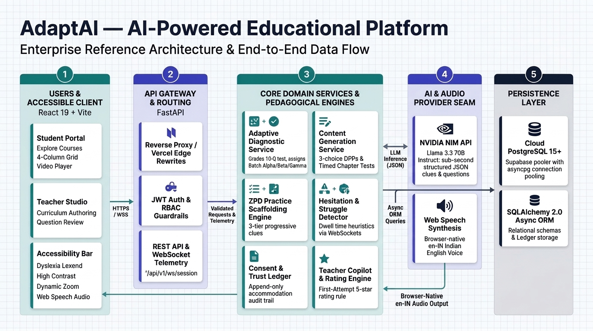

# AdaptAI: AI-Powered Educational Platform

[](https://www.python.org/)
[](https://fastapi.tiangolo.com/)
[](https://react.dev/)
[](https://www.typescriptlang.org/)
[](https://www.postgresql.org/)
[](https://www.w3.org/WAI/standards-guidelines/wcag/)
[](backend/tests/)
[](LICENSE)

**AdaptAI** is an inclusive, accessible educational web platform built to provide a calm, friendly, and adaptive learning environment for all students, featuring specialized sensory and pedagogical accommodations for neurodivergent learners - including **Attention-Deficit/Hyperactivity Disorder (ADHD)**, **Autism Spectrum Disorder (ASD)**, and **Dyslexia**.

AdaptAI pairs genuine teacher-authored curricula with low-latency multimodal AI assistance: real-time spoken audio clues, plain-language text hints, 3-choice practice problems, server-timed chapter tests with first-attempt grade integrity, and an immutable learner consent ledger - all engineered with sensory clarity, high contrast, and zero cognitive overload.

---

## 📑 Table of Contents

- [Core Pillars & Philosophy](#-core-pillars--philosophy)
- [System Architecture & Design](#-system-architecture--design)
- [Repository & Folder Architecture](#-repository--folder-architecture)
- [Key User Workflows](#-key-user-workflows)
- [Accessibility Features (WCAG 2.2 AA)](#-accessibility-features-wcag-22-aa)
- [Local Setup & Installation](#-local-setup--installation)
- [Environment Variables Reference](#-environment-variables-reference)
- [Production Deployment](#-production-deployment)
- [Testing & Quality Verification](#-testing--quality-verification)
- [License](#-license)

---

## 🌟 Core Pillars & Philosophy

1. **Batches Determined by Performance, Not Chronological Age:**
   Students are never confined or held back by birth year. Instead, learners earn their placement through an adaptive **Enrollment Test**, placing them objectively into **Batch Alpha**, **Batch Beta**, or **Batch Gamma**.
2. **Upward-Inclusive Course Discovery:**
   Learners always have upward mobility. A student in Batch Beta can view and enroll in all Batch Beta courses as well as higher-tier Batch Gamma courses, ensuring no artificial ceiling is placed on curiosity.
3. **Student Autonomy & Non-Forced Enrollment:**
   Completing the diagnostic test generates tailored course suggestions with a *"⭐ Best Match"* highlight, but never forcibly signs the student up. Learners maintain full agency to enroll immediately or explore available courses at their own pace.
4. **Scaffolded Multimodal Hints (Text & Indian English Voice):**
   Practice clues follow Vygotsky’s Zone of Proximal Development (ZPD) across 3 progressive tiers: *Orientation*, *Concept Reminder*, and *Targeted Stepping Stone*. Hints are rendered in clear text and spoken aloud using the browser's native Web Speech API (`en-IN` voice) to reduce reading fatigue for dyslexic and ADHD learners.
5. **The First-Attempt Rule (Teacher Fairness & Student Mastery):**
   Students enjoy unlimited practice and test retakes for mastery learning. However, public course star ratings (1 to 5 stars) and educator analytics are computed strictly from students' **initial test attempts**, preventing rating distortion while encouraging stress-free practice.
6. **Immutable Consent & Trust Ledger:**
   Every assistive accommodation proposed by the system (e.g., extra time, simplified phrasing, worked examples) requires explicit student or parent approval and is permanently recorded in a tamper-evident, append-only ledger.
7. **Direct, High-Performance Architecture:**
   Zero multi-agent orchestration overhead or complex framework lock-in. A direct service layer and native AI provider seam (NVIDIA NIM, Groq, OpenAI, Gemini) deliver sub-second structured JSON responses with deterministic offline mock fallbacks.

---

## 📐 System Architecture & Design

<p align="center">
  
</p>

AdaptAI uses a decoupled client-service architecture optimized for speed, reliability, and accessibility:

```
┌───────────────────────────────────────────────────────────────────────────────┐
│                       Accessible Frontend Client (SPA)                        │
│                         React 19 + TypeScript 5 + Vite                        │
│                                                                               │
│  • Student Workspace: Explore Courses, My Courses (4-col grid), Profile       │
│  • Registration Flow: Auto-redirect modal to 10-question Enrollment Test      │
│  • Course Study Room: Embedded video player, 3-choice DPPs, Timed Tests       │
│  • Multimodal Scaffolding: Progressive ZPD clues + Web Speech API (en-IN)    │
│  • Accessibility Bar: Dyslexia font (Lexend), High Contrast, Dynamic Zoom    │
│  • Teacher Studio: Course authoring, AI DPP/Test generator, Question review   │
│  • Real-Time Telemetry: Rolling-window dwell time & hesitation tracker        │
└──────────────────────────────────────┬────────────────────────────────────────┘
                                       │ REST API (JSON) & WebSocket /api/v1/ws/session
┌──────────────────────────────────────▼────────────────────────────────────────┐
│                        API Gateway & Security Layer                           │
│                      FastAPI 0.115+ + Uvicorn + PyJWT                         │
│                                                                               │
│  • Authentication: OAuth2 Password Bearer with JWT tokens & native bcrypt    │
│  • Role-Based Guardrails: Strict student vs teacher endpoint authorization    │
│  • Dynamic CORS: Support for local development, Vercel edge, and Render hosts│
│  • WebSocket Channel: High-frequency telemetry signal ingestion              │
└──────────────────────────────────────┬────────────────────────────────────────┘
                                       │
┌──────────────────────────────────────▼────────────────────────────────────────┐
│                        Core Modular Domain Services                           │
│                                                                               │
│  ├─ diagnostic_service: 10-Q test grading & Alpha/Beta/Gamma batch placement  │
│  ├─ course_service: Curricula, chapters, lectures, and DPP association       │
│  ├─ practice_service: Scaffolded hint formulation & practice attempt tracking │
│  ├─ test_service: Timed test submission & first-attempt rating isolation     │
│  ├─ struggle_service: Telemetry signal processing & hesitation scoring       │
│  ├─ consent_service: Append-only ledger for accommodation approvals/revocations│
│  └─ teacher_service: Classroom mastery metrics & teacher copilot insights     │
└───────────────────┬───────────────────────────────────────┬───────────────────┘
                    │                                       │
┌───────────────────▼───────────────────┐   ┌───────────────▼───────────────────┐
│         Direct AI Provider Seam       │   │         Persistence Layer         │
│                                       │   │                                   │
│ • NVIDIA NIM (Llama 3.3 70B Instruct) │   │ • PostgreSQL 15+ (Cloud Supabase) │
│ • Multi-Provider: Groq, Gemini, OpenAI│   │ • Asyncpg Connection Pooling      │
│ • Deterministic Mock Offline Fallback │   │ • SQLAlchemy 2.0 Async ORM        │
│ • Sub-second structured JSON schemas  │   │ • Alembic Schema Migrations       │
│ • Zero agent framework latency bloat  │   │ • In-Memory SQLite Test Fallback  │
└───────────────────────────────────────┘   └───────────────────────────────────┘
```

### 🔄 Key Architectural Mechanics Explained

#### 1. Vercel Edge Rewrite Proxy (`frontend/vercel.json`)
* **What it is:** A high-speed reverse proxy rule evaluated at Vercel's global Edge CDN network closest to the student.
* **Why it is used:** The frontend Single-Page Application (SPA) is hosted on Vercel (`https://<your-app>.vercel.app`), while the FastAPI backend service runs on Render (`https://adaptai-backend.onrender.com`).
* **How it works:**
  ```json
  {
    "rewrites": [
      {
        "source": "/api/:path*",
        "destination": "https://adaptai-backend.onrender.com/api/:path*"
      },
      {
        "source": "/(.*)",
        "destination": "/index.html"
      }
    ]
  }
  ```
  When the React application sends a request to `/api/v1/courses`, the browser sends it to its own origin (`https://<your-app>.vercel.app/api/v1/courses`). Vercel's Edge servers transparently proxy the request server-to-server to Render's backend, receive the response, and return it to the browser.
* **Key Benefits:**
  * **Zero CORS Errors:** The browser only talks to its own domain, completely eliminating cross-origin pre-flight `OPTIONS` blocks and latency.
  * **Zero Frontend Environment Variables:** No need to hardcode or expose backend URLs (`VITE_API_BASE_URL`) inside client-side JavaScript bundles.
  * **Fast Edge Delivery:** Cached static assets are served from Vercel PoPs, while dynamic API calls route smoothly to the backend.

#### 2. Real-Time WebSocket Telemetry (`/api/v1/ws/session`) & Struggle Detection
* **What it is:** A persistent, low-latency, bidirectional WebSocket connection streaming student behavioral telemetry in real time from `frontend/src/instrumentation/tracker.ts` to `backend/app/api/v1/struggle.py`.
* **Why it is used:** Traditional LMS platforms only discover a student is struggling *after* they fail a test. For neurodivergent learners (ADHD, Dyslexia, ASD), prolonged unassisted struggle creates cognitive freeze, anxiety, and task abandonment.
* **Telemetry Signals Ingested:**
  * **Dwell Time:** Measures inactivity or prolonged pauses (>45s) on a single problem without interaction.
  * **Option Flips & Hesitation:** Detects rapid toggling between choices (e.g., A → B → A → C), signaling confusion between distractor answers.
  * **Hint Request Bursts:** Identifies escalating reliance on hints within a short time window.
* **Pedagogical Intervention:** The `StruggleDetectionAgent` evaluates incoming signals over a sliding window. When elevated struggle is detected, AdaptAI proactively formulates and delivers a calm, 3-tier scaffolded Zone of Proximal Development (ZPD) hint (accompanied by optional spoken Indian English audio via the Web Speech API) to guide the student forward before frustration sets in.

---

## 📂 Repository & Folder Architecture

```text
AdaptAI/
├── .env.example                     # Environment template with documented settings
├── .gitignore                       # Clean ignore rules (protects .env, venv, caches)
├── docker-compose.yml               # Containerized local/server stack (DB, API, Web)
├── PROJECT.md                       # Comprehensive system specification & knowledge base
├── README.md                        # Primary project documentation & setup guide
├── render.yaml                      # Render Blueprint for automated backend deployment
│
├── backend/                         # FastAPI Backend Application
│   ├── alembic.ini                  # Alembic database migration configuration
│   ├── Dockerfile                   # Production Python 3.11 slim containerfile
│   ├── requirements.txt             # Python production dependencies
│   ├── alembic/                     # Database migration scripts
│   │   ├── env.py                   # Async Alembic migration environment
│   │   └── versions/                # Versioned schema migration files
│   │
│   ├── app/                         # Core Application Package
│   │   ├── main.py                  # FastAPI app factory, CORS, and router registration
│   │   ├── agents/                  # Specialized pedagogical & analytical agents
│   │   │   ├── consent_trust.py     # Manages accommodation consent ledger
│   │   │   ├── content_generation.py# Generates 3-choice DPPs and chapter tests
│   │   │   ├── diagnostic_placement.py # Evaluates enrollment test & assigns batches
│   │   │   ├── struggle_detection.py# Detects student dwell-time and hesitation
│   │   │   ├── teacher_copilot.py   # Analytics & first-attempt rating calculations
│   │   │   └── zpd_hint.py          # 3-tier progressive clue formulation
│   │   │
│   │   ├── api/v1/                  # REST API Route Endpoints
│   │   │   ├── analytics.py         # Teacher mastery & learner struggle metrics
│   │   │   ├── auth.py              # User registration, login, and `/me` verification
│   │   │   ├── consent.py           # Student/parent accommodation consent endpoints
│   │   │   ├── content_gen.py       # AI DPP and chapter test generation endpoints
│   │   │   ├── courses.py           # Course catalog, chapters, lectures, and enrollment
│   │   │   ├── diagnostic.py        # Diagnostic enrollment test question delivery & submission
│   │   │   ├── health.py            # Service health check (`/api/v1/health`)
│   │   │   ├── practice.py          # DPP practice session initiation & answer submission
│   │   │   ├── reference.py         # Seeded reference data (disabilities, age bands)
│   │   │   ├── struggle.py          # Telemetry signal ingestion & WebSocket handler
│   │   │   └── tests.py             # Timed chapter test sessions & rating updates
│   │   │
│   │   ├── core/                    # Core System Configuration & Utilities
│   │   │   ├── config.py            # Pydantic v2 application settings & environment bindings
│   │   │   ├── logging.py           # Structured JSON application logger
│   │   │   └── security.py          # Password hashing, JWT creation & token validation
│   │   │
│   │   ├── db/                      # Database Models, Session, and Seed Loader
│   │   │   ├── base.py              # Declarative SQLAlchemy base with UTC mixins
│   │   │   ├── session.py           # Async engine & sessionmaker (asyncpg / aiosqlite)
│   │   │   ├── seed_loader.py       # Idempotent loader for reference taxonomy data
│   │   │   ├── models/              # SQLAlchemy Data Models
│   │   │   │   ├── adaptation.py    # Consent ledger & accommodation proposals
│   │   │   │   ├── analytics.py     # Teacher ratings & aggregate analytics
│   │   │   │   ├── auth.py          # User accounts, students, and teachers
│   │   │   │   ├── course.py        # Courses, chapters, lectures, and enrollments
│   │   │   │   ├── diagnostic.py    # Diagnostic attempts & answer records
│   │   │   │   ├── practice.py      # DPP questions, sessions, and hint logs
│   │   │   │   ├── reference.py     # Age bands, disabilities, scaffold levels
│   │   │   │   ├── struggle.py      # Telemetry signals & struggle session state
│   │   │   │   └── test.py          # Timed test definitions, attempts, and answers
│   │   │   └── seed/                # Reference YAML seeds (disabilities, age bands)
│   │   │
│   │   ├── llm/                     # Direct AI Provider Seam
│   │   │   ├── base.py              # LLMProvider abstract interface
│   │   │   ├── factory.py           # Dynamic provider factory (NVIDIA, Groq, OpenAI, Fake)
│   │   │   └── providers/           # Concrete provider implementations
│   │   │
│   │   ├── schemas/                 # Pydantic Request/Response Validation Schemas
│   │   ├── services/                # Core Domain Services (Business Logic)
│   │   ├── speech/                  # Text-to-Speech & Speech-to-Text provider seams
│   │   └── video/                   # Video store & YouTube reference streaming seam
│   │
│   └── tests/                       # Automated Test Suite (Pytest)
│       ├── test_auth.py             # Authentication & role guardrail tests
│       ├── test_content_gen.py      # AI DPP and test generation schema validation
│       ├── test_diagnostic.py       # 10-Q test evaluation and batch placement tests
│       ├── test_e2e_acceptance.py   # Full student/teacher end-to-end acceptance flow
│       ├── test_practice_hints.py   # 3-tier ZPD hint progression tests
│       └── test_timed_tests_and_rating.py # First-attempt rating isolation tests
│
├── frontend/                        # Vite + React 19 Single Page Application
│   ├── index.html                   # HTML entry point with Lexend font preloading
│   ├── package.json                 # Frontend dependencies (React 19, Lucide icons)
│   ├── tsconfig.json                # Strict TypeScript configuration
│   ├── vercel.json                  # Production Vercel SPA routing & API reverse proxy
│   ├── vite.config.ts               # Vite bundler config with local `/api` proxy
│   │
│   ├── public/                      # Static Assets & SPA Rewrite Fallbacks
│   │   └── _redirects               # Netlify/Render static SPA redirect fallback
│   │
│   └── src/                         # Application Source Code
│       ├── App.tsx                  # Main router, navigation hub, and view controller
│       ├── index.css                # Sensory-friendly accessible design system & WCAG styles
│       ├── components/              # Shared Reusable Components
│       │   ├── AuthModal.tsx        # Login & registration modal with role selector
│       │   └── LoadingScreen.tsx    # Accessible, calming loading states
│       │
│       ├── context/                 # Application Contexts
│       │   └── AuthContext.tsx      # Authentication state, login, logout, and `/me` checks
│       │
│       ├── features/                # Domain Feature Modules
│       │   ├── student/             # Student Workspace Components
│       │   │   ├── ConsentDecisionCenter.tsx # Review and revoke AI accommodations
│       │   │   ├── CoursePurchaseModal.tsx   # Course enrollment confirmation modal
│       │   │   ├── CourseStudyRoom.tsx       # Embedded video player & chapter navigation
│       │   │   ├── PracticeSession.tsx       # 3-choice DPPs, ZPD clues & Indian TTS speech
│       │   │   ├── StudentDashboard.tsx      # Explore Courses, My Courses (4-col grid)
│       │   │   ├── StudentOnboarding.tsx     # 10-question adaptive enrollment test
│       │   │   └── TimedChapterTest.tsx      # Timed assessments with first-attempt flag
│       │   │
│       │   └── teacher/             # Teacher Workspace Components
│       │       ├── CourseAuthoringModal.tsx  # Create courses, chapters & syllabus topics
│       │       ├── QuestionReviewModal.tsx   # Review, edit, or delete AI questions
│       │       ├── TeacherCoursesManager.tsx # Course management and DPP studio launcher
│       │       └── TeacherDashboard.tsx      # Student mastery analytics & 5-star ratings
│       │
│       ├── instrumentation/         # Telemetry & Signal Collectors
│       │   └── tracker.ts           # Dwell time, hesitation, and option flip tracking
│       │
│       └── utils/                   # Helper Utilities
│           └── studentGroup.ts      # Batch formatting & upward-visibility logic
│
├── docs/                            # Architectural Documentation & Assets
│   └── assets/                      # System architecture diagrams & infographics
│       └── system_architecture.jpg  # Generated AdaptAI system design visual
│
└── eval/                            # Evaluation & Benchmark Harness
    └── run_evaluation.py            # Automated benchmark evaluation runner
```

---

## 🎯 Key User Workflows

### 🎓 Student Learning Journey

1. **Registration & Orientation:**
   - The student creates an account with their display name, age, and declared learning preference (e.g., ADHD, Dyslexia, ASD, or General).
   - An informative onboarding modal appears, explaining that every learner takes the adaptive Enrollment Test to find their optimal starting point.
2. **Adaptive Diagnostic Enrollment Test:**
   - A calm, stress-free 10-question assessment spanning English, Science, Mathematics, and Logical Reasoning.
   - Designed without timer pressure, featuring clear typography and high-contrast visuals.
3. **Performance-Driven Batch Placement:**
   - **Score < 50%:** Placed in **Batch Alpha** (Foundational learning track).
   - **Score 50% – 75%:** Placed in **Batch Beta** (Intermediate learning track).
   - **Score > 75%:** Placed in **Batch Gamma** (Advanced learning track).
   - The system presents a tailored course recommendation matching their track.
4. **Autonomous Enrollment Decision:**
   - **`✓ Enrol in Suggested Course →`**: Enrolls immediately and opens the interactive study room.
   - **`Explore Courses →`**: Skips immediate enrollment and navigates to the dashboard with the earned batch active. The recommended course is badged with *"⭐ Best Match"*, and the student can self-enroll in that course or any eligible course whenever ready.
5. **Interactive Course Study Room & Daily Practice:**
   - Watch bite-sized video lessons embedded directly within the course viewer.
   - Solve 3-choice Daily Practice Problems (DPP) tailored to the lesson.
   - Request scaffolded Zone of Proximal Development (ZPD) clues with one click.
   - Listen to clues spoken aloud in natural Indian English (`en-IN`) voice to prevent reading fatigue.
   - Take server-timed chapter tests with unlimited practice retakes for mastery learning.

---

### 👩‍🏫 Teacher & Educator Studio

1. **Structured Curriculum Authoring:**
   - Create courses categorized by subject, student track, and description.
   - Add structured chapters, syllabus topics, and streaming video references.
2. **AI Practice & Test Generation Studio:**
   - Generate aligned Daily Practice Problems (DPP) and chapter tests with exactly 3 answer choices (A, B, C) directly from teacher topic notes.
   - Powered directly by high-performance LLMs (e.g., NVIDIA Llama 3.3 70B) for instant generation.
3. **Human-in-the-Loop Question Review:**
   - Review AI-generated questions in real time: edit question text, adjust correct answers, delete questions, or manually add custom problems before publishing to students.
4. **Transparent Analytics & First-Attempt Ratings:**
   - View classroom progress, chapter test averages, and student hesitation metrics.
   - Track transparent 5-star course quality ratings derived strictly from students' initial test attempts.

---

## ♿ Accessibility Features (WCAG 2.2 AA)

- **Mindful Teal Color Palette:** Sensory-gentle palette (`#0f766e` accent, `#f8fafc` background) tested for zero visual glare and non-overstimulating interaction.
- **Dyslexia-Friendly Typography:** One-click toggle switching the entire interface font stack to **Lexend** with increased letter-spacing and word-spacing.
- **High-Contrast Mode:** High-contrast color scheme designed for visual comfort and reduced eye fatigue.
- **Dynamic Text Scaling:** Dedicated `A-`, `Reset`, and `A+` buttons allowing students to scale text size across all views.
- **Spoken Audio Narration:** Browser-native Web Speech API synthesis delivering spoken audio hints in Indian English (`en-IN`) without requiring paid third-party voice APIs.
- **Consent Decision Center:** An append-only audit trail allowing students and parents to review, approve, or revoke any AI accommodation at any time.
- **Full-Width Responsive 4-Column Grid:** Balanced card layout adapting smoothly from widescreen monitors (4 columns, zero empty side gaps) down to mobile displays.

---

## 🚀 Local Setup & Installation

### Prerequisites

- **Python:** 3.11, 3.12, or 3.13
- **Node.js:** v18.0.0 or higher (v20+ recommended)
- **PostgreSQL:** Cloud Supabase, Neon, or local PostgreSQL (*SQLite in-memory fallback supported automatically if no database URL is set*)
- **Git**

---

### Step 1: Clone the Repository

```bash
git clone https://github.com/Giradhar744/AdaptAI.git
cd AdaptAI
```

---

### Step 2: Backend Setup (FastAPI)

1. **Navigate to the backend directory:**
   ```bash
   cd backend
   ```

2. **Create and activate a Python virtual environment:**
   - **Windows (PowerShell):**
     ```powershell
     python -m venv venv
     .\venv\Scripts\Activate.ps1
     ```
   - **macOS / Linux:**
     ```bash
     python3 -m venv venv
     source venv/bin/activate
     ```

3. **Install dependencies:**
   ```bash
   pip install -r requirements.txt
   ```

4. **Configure Environment Variables:**
   Create a `.env` file in the project root by copying the template:
   ```bash
   cp ../.env.example ../.env
   ```
   Open `../.env` and set your database connection string and API keys:
   ```env
   # Database (Cloud Supabase or local PostgreSQL)
   DATABASE_URL=postgresql+asyncpg://postgres:[PASSWORD]@[HOST]:5432/postgres
   DATABASE_SYNC_URL=postgresql://postgres:[PASSWORD]@[HOST]:5432/postgres

   # Security
   JWT_SECRET=your-secure-random-jwt-secret-at-least-32-chars

   # AI Provider: 'nvidia', 'fake', 'gemini', 'openai', or 'groq'
   LLM_PROVIDER=nvidia
   NVIDIA_API_KEY=nvapi-your-key-from-build.nvidia.com
   NVIDIA_MODEL=meta/llama-3.3-70b-instruct

   # Voice & Media
   TTS_PROVIDER=browser
   STT_PROVIDER=fake
   VIDEO_PROVIDER=fake
   ```

5. **Start the Backend Server:**
   ```bash
   uvicorn app.main:app --reload --port 8000
   ```
   - **Interactive API Documentation (Swagger):** [http://localhost:8000/docs](http://localhost:8000/docs)
   - **Alternative API Docs (ReDoc):** [http://localhost:8000/redoc](http://localhost:8000/redoc)
   - **Health Check Endpoint:** [http://localhost:8000/api/v1/health](http://localhost:8000/api/v1/health)

---

### Step 3: Frontend Setup (React + Vite)

1. **Open a new terminal window and navigate to the frontend directory:**
   ```bash
   cd frontend
   ```

2. **Install dependencies:**
   ```bash
   npm install
   ```

3. **Start the Vite development server:**
   ```bash
   npm run dev
   ```

4. **Launch the application:**
   Open your browser and navigate to:
   👉 **[http://localhost:5173](http://localhost:5173)**

---

## ⚙️ Environment Variables Reference

| Variable | Default Value | Description |
| :--- | :--- | :--- |
| `ENVIRONMENT` | `development` | Deployment environment (`development` / `production`). |
| `DEBUG` | `true` | Enables verbose FastAPI debug output. |
| `PORT` | `8000` | Port for the Uvicorn backend server. |
| `HOST` | `0.0.0.0` | Host binding for the backend server. |
| `DATABASE_URL` | `postgresql+asyncpg://...` | Async PostgreSQL connection string for application runtime. |
| `DATABASE_SYNC_URL` | `postgresql://...` | Synchronous PostgreSQL connection string for Alembic migrations. |
| `JWT_SECRET` | *required in prod* | Secret key for signing authentication tokens (min 32 characters). |
| `JWT_ALGORITHM` | `HS256` | JWT signing algorithm. |
| `JWT_EXPIRE_MINUTES` | `1440` | JWT expiration time (default: 24 hours). |
| `LLM_PROVIDER` | `nvidia` | AI provider for hint/question generation (`nvidia`, `gemini`, `groq`, `openai`, `fake`). |
| `NVIDIA_API_KEY` | `nvapi-...` | Free API key from [build.nvidia.com](https://build.nvidia.com). |
| `NVIDIA_MODEL` | `meta/llama-3.3-70b-instruct` | NVIDIA NIM model identifier. |
| `TTS_PROVIDER` | `browser` | Text-to-Speech provider (`browser` uses native Web Speech API with `en-IN` voice; `fake` for mock). |
| `STT_PROVIDER` | `fake` | Speech-to-Text provider seam (`fake` avoids paid transcription dependencies). |
| `VIDEO_PROVIDER` | `fake` | Video storage seam (`fake` serves embedded YouTube lesson streams). |

---

## 🌐 Production Deployment

AdaptAI is pre-configured for modern, zero-cost cloud deployment:

### Recommended Setup: Vercel (Frontend) + Render (Backend) + Supabase (Database)

```
┌────────────────────────┐      ┌────────────────────────┐      ┌────────────────────────┐
│     Vercel (Edge)      │      │    Render (Python)     │      │   Supabase (Cloud DB)  │
│  React 19 + TypeScript │ ───► │  FastAPI + Asyncpg     │ ───► │  PostgreSQL 15+        │
│  (Zero-config deploy)  │      │  (Persistent WebSockets│      │  (Connection Pooling)  │
└────────────────────────┘      └────────────────────────┘      └────────────────────────┘
```

1. **Database:** Create a free project on **[Supabase](https://supabase.com/)** and copy your pooled connection string.
2. **Backend (Render):**
   - In **[Render](https://render.com/)**, click **New Web Service** and connect this repository.
   - Set **Root Directory** to `backend`.
   - Set **Build Command** to `pip install -r requirements.txt`.
   - Set **Start Command** to `uvicorn app.main:app --host 0.0.0.0 --port $PORT`.
   - Add environment variables: `DATABASE_URL`, `JWT_SECRET`, `LLM_PROVIDER=nvidia`, and `NVIDIA_API_KEY`.
   - *Pro-Tip:* Ping `https://your-backend.onrender.com/api/v1/health` every 10 minutes via [UptimeRobot](https://uptimerobot.com) to prevent free-tier spin-down.
3. **Frontend (Vercel):**
   - In **[Vercel](https://vercel.com/)**, import this repository and set **Root Directory** to `frontend`.
   - The included [`frontend/vercel.json`](frontend/vercel.json) automatically proxies `/api/*` requests to your Render backend with zero CORS issues.
   - Click **Deploy**.

---

## 🧪 Testing & Quality Verification

### Run Automated Pytest Suite
Execute all backend tests, covering authentication guardrails, diagnostic grading, ZPD hints, and rating isolation:
```bash
python -m pytest backend/tests/ -v
```

### Run End-to-End Acceptance Test
Execute the end-to-end multi-step acceptance script simulating complete student and teacher workflows:
```bash
python backend/tests/test_e2e_acceptance.py
```

### Validate Frontend Compilation
Ensure strict TypeScript typing and production bundle optimization:
```bash
cd frontend && npm run build
```

---

## 📄 License

This project is licensed under the MIT License - see the [LICENSE](LICENSE) file for details.
